# DER - Modelo fisico Oracle (CIVIA)

Gerado a partir do script da equipe `db/01_ddl.sql` (17 tabelas). PK = chave primaria, FK = chave estrangeira, UK = unica. Cardinalidade: `||` obrigatorio, `|o` opcional, `o{` zero ou muitos, `o|` zero ou um.

A API Java mapeia as 17 tabelas: as 10 do mapa de servicos (T_ORGANIZACAO, T_TIPO_SERVICO, T_PERFIL_ATENDIDO, T_SERVICO, T_SERVICO_PERFIL, T_HORARIO, T_USUARIO_PAINEL, T_ATUALIZACAO, T_TOTEM e T_CONSULTA_TOTEM) e as 7 do modulo de reciclagem (T_POSTO_RECICLAGEM, T_MATERIAL, T_CARTAO, T_ENTREGA, T_RECOMPENSA, T_TROCA e T_COLETA).

```mermaid
erDiagram
  ORGANIZACAO {
  NUMBER id_organizacao PK "10, NOT NULL"
  VARCHAR2 nm_organizacao UK "120, NOT NULL"
  VARCHAR2 tp_organizacao "20, NOT NULL"
  VARCHAR2 nr_telefone "15, NULL"
  VARCHAR2 ds_email "120, NULL"
  }
  TIPO_SERVICO {
  NUMBER id_tipo_servico PK "3, NOT NULL"
  VARCHAR2 nm_tipo_servico UK "40, NOT NULL"
  VARCHAR2 ds_icone "30, NOT NULL"
  }
  PERFIL_ATENDIDO {
  NUMBER id_perfil PK "3, NOT NULL"
  VARCHAR2 ds_perfil UK "40, NOT NULL"
  }
  SERVICO {
  NUMBER id_servico PK "10, NOT NULL"
  NUMBER id_organizacao FK "10, NOT NULL"
  NUMBER id_tipo_servico FK "3, NOT NULL"
  VARCHAR2 nm_servico "120, NOT NULL"
  VARCHAR2 ds_logradouro "120, NOT NULL"
  VARCHAR2 nr_endereco "10, NULL"
  VARCHAR2 nm_bairro "60, NOT NULL"
  NUMBER nr_latitude "9,6, NOT NULL"
  NUMBER nr_longitude "9,6, NOT NULL"
  NUMBER nr_capacidade "5, NULL"
  CHAR fl_24h "1, NOT NULL"
  VARCHAR2 st_aprovacao "10, NOT NULL"
  DATE dt_cadastro "NOT NULL"
  }
  SERVICO_PERFIL {
  NUMBER id_servico PK,FK "10, NOT NULL"
  NUMBER id_perfil PK,FK "3, NOT NULL"
  }
  HORARIO {
  NUMBER id_horario PK "10, NOT NULL"
  NUMBER id_servico FK "10, NOT NULL"
  NUMBER nr_dia_semana "1, NOT NULL"
  VARCHAR2 hr_abertura "5, NOT NULL"
  VARCHAR2 hr_fechamento "5, NOT NULL"
  }
  USUARIO_PAINEL {
  NUMBER id_usuario PK "10, NOT NULL"
  NUMBER id_organizacao FK "10, NOT NULL"
  VARCHAR2 nm_usuario "100, NOT NULL"
  VARCHAR2 ds_email UK "120, NOT NULL"
  VARCHAR2 tp_perfil_acesso "12, NOT NULL"
  CHAR fl_ativo "1, NOT NULL"
  }
  ATUALIZACAO {
  NUMBER id_atualizacao PK "10, NOT NULL"
  NUMBER id_servico FK "10, NOT NULL"
  NUMBER id_usuario FK "10, NULL"
  VARCHAR2 st_disponibilidade "15, NOT NULL"
  NUMBER qt_vagas "5, NULL"
  VARCHAR2 tp_origem "15, NOT NULL"
  DATE dt_atualizacao "NOT NULL"
  }
  TOTEM {
  NUMBER id_totem PK "10, NOT NULL"
  VARCHAR2 cd_totem UK "12, NOT NULL"
  VARCHAR2 ds_logradouro "120, NOT NULL"
  VARCHAR2 nm_bairro "60, NOT NULL"
  NUMBER nr_latitude "9,6, NOT NULL"
  NUMBER nr_longitude "9,6, NOT NULL"
  VARCHAR2 st_totem "12, NOT NULL"
  CHAR fl_papel_impressora "1, NOT NULL"
  DATE dt_instalacao "NOT NULL"
  DATE dt_ultima_sincronizacao "NULL"
  }
  CONSULTA_TOTEM {
  NUMBER id_consulta PK "10, NOT NULL"
  NUMBER id_totem FK "10, NOT NULL"
  NUMBER id_tipo_servico FK "3, NOT NULL"
  NUMBER id_perfil FK "3, NULL"
  NUMBER id_servico_escolhido FK "10, NULL"
  DATE dt_consulta "NOT NULL"
  CHAR fl_imprimiu_rota "1, NOT NULL"
  CHAR fl_pediu_abordagem "1, NOT NULL"
  VARCHAR2 cd_chegada UK "8, NULL"
  DATE dt_chegada "NULL"
  }
  POSTO_RECICLAGEM {
  NUMBER id_posto PK "10, NOT NULL"
  NUMBER id_totem FK,UK "10, NOT NULL"
  NUMBER id_cooperativa FK "10, NOT NULL"
  NUMBER nr_capacidade_kg "6,2, NOT NULL"
  NUMBER nr_limite_diario_kg "5,2, NOT NULL"
  VARCHAR2 st_posto "12, NOT NULL"
  }
  MATERIAL {
  NUMBER id_material PK "3, NOT NULL"
  VARCHAR2 nm_material UK "40, NOT NULL"
  NUMBER nr_creditos_por_kg "5, NOT NULL"
  CHAR fl_aceito "1, NOT NULL"
  }
  CARTAO {
  NUMBER id_cartao PK "10, NOT NULL"
  VARCHAR2 cd_cartao UK "10, NOT NULL"
  NUMBER id_organizacao_emissora FK "10, NOT NULL"
  NUMBER id_cartao_anterior FK,UK "10, NULL"
  DATE dt_emissao "NOT NULL"
  VARCHAR2 st_cartao "10, NOT NULL"
  NUMBER nr_saldo_creditos "8, NOT NULL"
  }
  ENTREGA {
  NUMBER id_entrega PK "10, NOT NULL"
  NUMBER id_cartao FK "10, NOT NULL"
  NUMBER id_posto FK "10, NOT NULL"
  NUMBER id_material FK "3, NOT NULL"
  NUMBER nr_peso_kg "5,2, NOT NULL"
  NUMBER nr_creditos_gerados "6, NOT NULL"
  DATE dt_entrega "NOT NULL"
  }
  RECOMPENSA {
  NUMBER id_recompensa PK "10, NOT NULL"
  NUMBER id_organizacao_parceira FK "10, NOT NULL"
  VARCHAR2 nm_recompensa UK "80, NOT NULL"
  NUMBER nr_custo_creditos "6, NOT NULL"
  CHAR fl_ativo "1, NOT NULL"
  }
  TROCA {
  NUMBER id_troca PK "10, NOT NULL"
  NUMBER id_cartao FK "10, NOT NULL"
  NUMBER id_recompensa FK "10, NOT NULL"
  NUMBER id_usuario FK "10, NOT NULL"
  NUMBER nr_creditos_usados "6, NOT NULL"
  DATE dt_troca "NOT NULL"
  }
  COLETA {
  NUMBER id_coleta PK "10, NOT NULL"
  NUMBER id_posto FK "10, NOT NULL"
  NUMBER id_cooperativa FK "10, NOT NULL"
  NUMBER nr_peso_total_kg "7,2, NOT NULL"
  DATE dt_coleta "NOT NULL"
  }
  ORGANIZACAO ||--o{ SERVICO : "id_organizacao"
  TIPO_SERVICO ||--o{ SERVICO : "id_tipo_servico"
  SERVICO ||--o{ SERVICO_PERFIL : "id_servico"
  PERFIL_ATENDIDO ||--o{ SERVICO_PERFIL : "id_perfil"
  SERVICO ||--o{ HORARIO : "id_servico"
  ORGANIZACAO ||--o{ USUARIO_PAINEL : "id_organizacao"
  SERVICO ||--o{ ATUALIZACAO : "id_servico"
  USUARIO_PAINEL |o--o{ ATUALIZACAO : "id_usuario"
  TOTEM ||--o{ CONSULTA_TOTEM : "id_totem"
  TIPO_SERVICO ||--o{ CONSULTA_TOTEM : "id_tipo_servico"
  PERFIL_ATENDIDO |o--o{ CONSULTA_TOTEM : "id_perfil"
  SERVICO |o--o{ CONSULTA_TOTEM : "id_servico_escolhido"
  TOTEM ||--o| POSTO_RECICLAGEM : "id_totem"
  ORGANIZACAO ||--o{ POSTO_RECICLAGEM : "id_cooperativa"
  ORGANIZACAO ||--o{ CARTAO : "id_organizacao_emissora"
  CARTAO |o--o| CARTAO : "id_cartao_anterior"
  CARTAO ||--o{ ENTREGA : "id_cartao"
  POSTO_RECICLAGEM ||--o{ ENTREGA : "id_posto"
  MATERIAL ||--o{ ENTREGA : "id_material"
  ORGANIZACAO ||--o{ RECOMPENSA : "id_organizacao_parceira"
  CARTAO ||--o{ TROCA : "id_cartao"
  RECOMPENSA ||--o{ TROCA : "id_recompensa"
  USUARIO_PAINEL ||--o{ TROCA : "id_usuario"
  POSTO_RECICLAGEM ||--o{ COLETA : "id_posto"
  ORGANIZACAO ||--o{ COLETA : "id_cooperativa"
```

Os ids sao gerados pelas sequencias de `db/02_sequencias.sql` (`SQ_<TABELA>`).

