# Diagrama de classes - CIVIA API

Gerado automaticamente a partir do codigo-fonte Java (`civia-*/src/main/java`), portanto reflete exatamente as classes do projeto. Os mesmos diagramas estao em PlantUML nos arquivos `.puml` desta pasta (`diagrama-classes-dominio.puml`, `diagrama-classes-camadas.puml` e `diagrama-classes-completo.puml`).

## 1. Camada de dominio

Modelo (entidades que correspondem as tabelas Oracle), value objects, excecoes de dominio e interfaces DAO.

```mermaid
---
title: CIVIA - Dominio
---
classDiagram
  direction TB
  class AtualizacaoDisponibilidade {
    +int MAXIMO_VAGAS$
    -Long id
    -Long servicoId
    -Long usuarioId
    -StatusDisponibilidade status
    -Integer vagas
    -OrigemAtualizacao origem
    -LocalDateTime dataHora
    +registrar(servico, usuarioId, status, vagas, origem, dataHora)$ AtualizacaoDisponibilidade
    +reconstituir(id, servicoId, usuarioId, status, vagas, origem, dataHora)$ AtualizacaoDisponibilidade
    +corrigir(servico, usuarioId, status, vagas, origem, dataHora) void
    +ehAnteriorA(instante) boolean
  }
  class AtualizacaoDisponibilidadeDAO {
    <<interface>>
    +salvar(atualizacao) AtualizacaoDisponibilidade
    +buscarPorId(id) Optional~AtualizacaoDisponibilidade~
    +listar(servicoId) List~AtualizacaoDisponibilidade~
    +buscarMaisRecentesPorServicos(servicoIds) Map~Long,AtualizacaoDisponibilidade~
    +existePorUsuario(usuarioId) boolean
    +excluir(id) void
    +excluirPorServico(servicoId) void
  }
  class Cartao {
    +int TAMANHO_CODIGO$
    -Long id
    -String codigo
    -Long organizacaoEmissoraId
    -Long cartaoAnteriorId
    -LocalDateTime dataEmissao
    -StatusCartao status
    -int saldoCreditos
    +emitir(codigo, organizacaoEmissoraId, dataEmissao)$ Cartao
    +substituir(anterior, codigo, organizacaoEmissoraId, dataEmissao)$ Cartao
    +reconstituir(id, codigo, organizacaoEmissoraId, cartaoAnteriorId, dataEmissao, status, saldoCreditos)$ Cartao
    +atualizar(organizacaoEmissoraId, novoStatus) void
    +creditar(creditos) void
    +debitar(creditos) void
    +garantirAtivo() void
  }
  class CartaoDAO {
    <<interface>>
    +salvar(cartao) Cartao
    +buscarPorId(id) Optional~Cartao~
    +buscarPorCodigo(codigo) Optional~Cartao~
    +listar(status) List~Cartao~
    +existePorCodigo(codigo) boolean
    +existeSubstituto(cartaoAnteriorId) boolean
    +excluir(id) void
  }
  class Coleta {
    -Long id
    -Long postoId
    -Long cooperativaId
    -BigDecimal pesoTotalKg
    -LocalDateTime dataColeta
    +registrar(postoId, cooperativaId, pesoTotalKg, dataColeta)$ Coleta
    +reconstituir(id, postoId, cooperativaId, pesoTotalKg, dataColeta)$ Coleta
    +atualizar(postoId, cooperativaId, pesoTotalKg, dataColeta) void
  }
  class ColetaDAO {
    <<interface>>
    +salvar(coleta) Coleta
    +buscarPorId(id) Optional~Coleta~
    +listar(postoId) List~Coleta~
    +ultimaColetaDoPosto(postoId) Optional~LocalDateTime~
    +existePorPosto(postoId) boolean
    +excluir(id) void
  }
  class ConsultaTotem {
    +int TAMANHO_CODIGO$
    -Long id
    -Long totemId
    -Integer tipoServicoId
    -Integer perfilId
    -Long servicoEscolhidoId
    -LocalDateTime dataConsulta
    -boolean imprimiuRota
    -boolean pediuAbordagem
    -String codigoChegada
    -LocalDateTime dataChegada
    +registrar(totemId, tipoServicoId, perfilId, servicoEscolhidoId, dataConsulta, imprimiuRota, pediuAbordagem, codigoGerado)$ ConsultaTotem
    +reconstituir(id, totemId, tipoServicoId, perfilId, servicoEscolhidoId, dataConsulta, imprimiuRota, pediuAbordagem, codigoChegada, dataChegada)$ ConsultaTotem
    +atualizar(totemId, tipoServicoId, perfilId, servicoEscolhidoId, imprimiuRota, pediuAbordagem, codigoGerado) void
    +registrarChegada(instante) void
    +chegadaRegistrada() boolean
  }
  class ConsultaTotemDAO {
    <<interface>>
    +salvar(consulta) ConsultaTotem
    +buscarPorId(id) Optional~ConsultaTotem~
    +buscarPorCodigoChegada(codigo) Optional~ConsultaTotem~
    +listar(totemId) List~ConsultaTotem~
    +existePorCodigoChegada(codigo) boolean
    +existePorTotem(totemId) boolean
    +existePorServico(servicoId) boolean
    +existePorTipo(tipoServicoId) boolean
    +existePorPerfil(perfilId) boolean
    +excluir(id) void
  }
  class Coordenada {
    <<record>>
    -double latitude
    -double longitude
    +de(latitude, longitude)$ Coordenada
    +distanciaEmMetrosAte(destino) double
  }
  class DadoInvalidoException {
  }
  class DomainException {
    <<abstract>>
  }
  class Endereco {
    <<record>>
    -String logradouro
    -String numero
    -String bairro
    +formatado() String
  }
  class Entrega {
    +BigDecimal PESO_MAXIMO_KG$
    -Long id
    -Long cartaoId
    -Long postoId
    -Integer materialId
    -BigDecimal pesoKg
    -int creditosGerados
    -LocalDateTime dataEntrega
    +registrar(cartaoId, postoId, material, pesoKg, dataEntrega)$ Entrega
    +reconstituir(id, cartaoId, postoId, materialId, pesoKg, creditosGerados, dataEntrega)$ Entrega
    +corrigir(cartaoId, postoId, material, pesoKg) void
  }
  class EntregaDAO {
    <<interface>>
    +salvar(entrega) Entrega
    +buscarPorId(id) Optional~Entrega~
    +listar(cartaoId, postoId) List~Entrega~
    +somarPesoDoCartao(cartaoId, inicio, fim, idIgnorado) BigDecimal
    +somarPesoDoPosto(postoId, desde, idIgnorado) BigDecimal
    +existePorCartao(cartaoId) boolean
    +existePorPosto(postoId) boolean
    +existePorMaterial(materialId) boolean
    +excluir(id) void
  }
  class GradeHorario {
    <<record>>
    -boolean funciona24h
    -List~Horario~ horarios
    +estaAbertoEm(instante) boolean
    +faixaAtual(instante) Optional~Horario~
    +proximaAberturaNoDia(instante) Optional~Horario~
  }
  class Horario {
    +LocalTime FIM_DO_DIA$
    -Long id
    -Long servicoId
    -int diaSemana
    -LocalTime abertura
    -LocalTime fechamento
    +novo(servicoId, diaSemana, abertura, fechamento)$ Horario
    +reconstituir(id, servicoId, diaSemana, abertura, fechamento)$ Horario
    +atualizar(diaSemana, abertura, fechamento) void
    +diaSemanaDe(dia)$ int
    +nomeDoDia(diaSemana)$ String
    +abrangeInstante(instante) boolean
  }
  class HorarioDAO {
    <<interface>>
    +salvar(horario) Horario
    +buscarPorId(id) Optional~Horario~
    +listarPorServico(servicoId) List~Horario~
    +listarPorServicos(servicoIds) Map~Long,List~Horario~~
    +existe(servicoId, diaSemana, abertura, idIgnorado) boolean
    +excluir(id) void
    +excluirPorServico(servicoId) void
  }
  class Material {
    -Integer id
    -String nome
    -int creditosPorKg
    -boolean aceito
    +novo(nome, creditosPorKg, aceito)$ Material
    +reconstituir(id, nome, creditosPorKg, aceito)$ Material
    +atualizar(nome, creditosPorKg, aceito) void
    +garantirAceito() void
    +calcularCreditos(pesoKg) int
  }
  class MaterialDAO {
    <<interface>>
    +salvar(material) Material
    +buscarPorId(id) Optional~Material~
    +listar() List~Material~
    +existePorNome(nome, idIgnorado) boolean
    +contar() long
    +excluir(id) void
  }
  class Organizacao {
    -Long id
    -String nome
    -TipoOrganizacao tipo
    -String telefone
    -String email
    +nova(nome, tipo, telefone, email)$ Organizacao
    +reconstituir(id, nome, tipo, telefone, email)$ Organizacao
    +atualizar(nome, tipo, telefone, email) void
  }
  class OrganizacaoDAO {
    <<interface>>
    +salvar(organizacao) Organizacao
    +buscarPorId(id) Optional~Organizacao~
    +listar(tipo) List~Organizacao~
    +existePorId(id) boolean
    +existePorNome(nome, idIgnorado) boolean
    +excluir(id) void
  }
  class OrigemAtualizacao {
    <<enumeration>>
    PAINEL
    CENTRAL_VAGAS
  }
  class PerfilAcesso {
    <<enumeration>>
    GESTOR
    EQUIPE
    COOPERATIVA
  }
  class PerfilAtendido {
    -Integer id
    -String descricao
    +novo(descricao)$ PerfilAtendido
    +reconstituir(id, descricao)$ PerfilAtendido
    +atualizar(descricao) void
    +temDescricao(outra) boolean
  }
  class PerfilAtendidoDAO {
    <<interface>>
    +salvar(perfil) PerfilAtendido
    +buscarPorId(id) Optional~PerfilAtendido~
    +buscarPorIds(ids) List~PerfilAtendido~
    +listar() List~PerfilAtendido~
    +existePorDescricao(descricao, idIgnorado) boolean
    +contar() long
    +excluir(id) void
  }
  class PostoReciclagem {
    +BigDecimal LIMITE_DIARIO_PADRAO_KG$
    -Long id
    -Long totemId
    -Long cooperativaId
    -BigDecimal capacidadeKg
    -BigDecimal limiteDiarioKg
    -StatusPosto status
    +novo(totemId, cooperativaId, capacidadeKg, limiteDiarioKg, status)$ PostoReciclagem
    +reconstituir(id, totemId, cooperativaId, capacidadeKg, limiteDiarioKg, status)$ PostoReciclagem
    +atualizar(totemId, cooperativaId, capacidadeKg, limiteDiarioKg, status) void
    +garantirRecebeEntregas() void
    +garantirCabe(acumuladoKg, pesoKg) void
    +atualizarLotacao(acumuladoKg) void
    +liberarAposColeta() void
  }
  class PostoReciclagemDAO {
    <<interface>>
    +salvar(posto) PostoReciclagem
    +buscarPorId(id) Optional~PostoReciclagem~
    +listar(status) List~PostoReciclagem~
    +existePorTotem(totemId, idIgnorado) boolean
    +excluir(id) void
  }
  class Recompensa {
    -Long id
    -Long organizacaoParceiraId
    -String nome
    -int custoCreditos
    -boolean ativo
    +nova(organizacaoParceiraId, nome, custoCreditos, ativo)$ Recompensa
    +reconstituir(id, organizacaoParceiraId, nome, custoCreditos, ativo)$ Recompensa
    +atualizar(organizacaoParceiraId, nome, custoCreditos, ativo) void
    +garantirDisponivel() void
  }
  class RecompensaDAO {
    <<interface>>
    +salvar(recompensa) Recompensa
    +buscarPorId(id) Optional~Recompensa~
    +listar(ativo) List~Recompensa~
    +existePorNome(nome, idIgnorado) boolean
    +excluir(id) void
  }
  class RegraNegocioVioladaException {
  }
  class Servico {
    +int CAPACIDADE_MAXIMA$
    -Long id
    -Long organizacaoId
    -TipoServico tipo
    -String nome
    -Endereco endereco
    -Coordenada coordenada
    -Integer capacidade
    -boolean funciona24h
    -StatusAprovacao statusAprovacao
    -LocalDateTime dataCadastro
    -Set~PerfilAtendido~ perfis
    +novo(organizacaoId, tipo, nome, endereco, coordenada, capacidade, funciona24h, statusAprovacao, dataCadastro, perfis)$ Servico
    +reconstituir(id, organizacaoId, tipo, nome, endereco, coordenada, capacidade, funciona24h, statusAprovacao, dataCadastro, perfis)$ Servico
    +atualizar(organizacaoId, tipo, nome, endereco, coordenada, capacidade, funciona24h, statusAprovacao, perfis) void
    +ehAbrigo() boolean
    +estaAprovado() boolean
    +atendePerfil(perfil) boolean
    +getPerfis() Set~PerfilAtendido~
  }
  class ServicoDAO {
    <<interface>>
    +salvar(servico) Servico
    +buscarPorId(id) Optional~Servico~
    +listar(tipoServicoId, statusAprovacao, organizacaoId) List~Servico~
    +existePorId(id) boolean
    +existePorOrganizacao(organizacaoId) boolean
    +existePorTipo(tipoServicoId) boolean
    +existePorPerfil(perfilId) boolean
    +excluir(id) void
  }
  class SituacaoServico {
    <<enumeration>>
    ABERTO
    FILA_GRANDE
    LOTADO
    FECHADO
  }
  class StatusAprovacao {
    <<enumeration>>
    PENDENTE
    APROVADO
    REPROVADO
  }
  class StatusCartao {
    <<enumeration>>
    ATIVO
    BLOQUEADO
  }
  class StatusDisponibilidade {
    <<enumeration>>
    TEM_VAGA
    POUCAS_VAGAS
    ABERTO
    FILA_GRANDE
    LOTADO
    FECHADO
    SEM_ATUALIZACAO_RECENTE
    -int grupoOrdenacao
    -boolean exigeVagas
    +getGrupoOrdenacao() int
    +exigeVagas() boolean
    +de(situacao)$ StatusDisponibilidade
  }
  class StatusPosto {
    <<enumeration>>
    ATIVO
    CHEIO
    MANUTENCAO
  }
  class StatusTotem {
    <<enumeration>>
    ONLINE
    OFFLINE
    MANUTENCAO
  }
  class TipoOrganizacao {
    <<enumeration>>
    CENTRO_POP
    ONG
    COOPERATIVA
    PREFEITURA
    PARCEIRO
  }
  class TipoServico {
    +String NOME_ABRIGO$
    -Integer id
    -String nome
    -String icone
    +novo(nome, icone)$ TipoServico
    +reconstituir(id, nome, icone)$ TipoServico
    +atualizar(nome, icone) void
    +ehAbrigo() boolean
    +temNome(outro) boolean
    +normalizar(texto)$ String
  }
  class TipoServicoDAO {
    <<interface>>
    +salvar(tipo) TipoServico
    +buscarPorId(id) Optional~TipoServico~
    +listar() List~TipoServico~
    +existePorNome(nome, idIgnorado) boolean
    +contar() long
    +excluir(id) void
  }
  class Totem {
    -Long id
    -String codigo
    -Endereco endereco
    -Coordenada coordenada
    -StatusTotem status
    -boolean papelImpressora
    -LocalDate dataInstalacao
    -LocalDateTime ultimaSincronizacao
    +novo(codigo, endereco, coordenada, status, papelImpressora, dataInstalacao, ultimaSincronizacao)$ Totem
    +reconstituir(id, codigo, endereco, coordenada, status, papelImpressora, dataInstalacao, ultimaSincronizacao)$ Totem
    +atualizar(codigo, endereco, coordenada, status, papelImpressora, dataInstalacao, ultimaSincronizacao) void
    +garantirDisponivelParaConsulta() void
  }
  class TotemDAO {
    <<interface>>
    +salvar(totem) Totem
    +buscarPorId(id) Optional~Totem~
    +listar() List~Totem~
    +existePorCodigo(codigo, idIgnorado) boolean
    +excluir(id) void
  }
  class Troca {
    -Long id
    -Long cartaoId
    -Long recompensaId
    -Long usuarioId
    -int creditosUsados
    -LocalDateTime dataTroca
    +registrar(cartaoId, recompensa, usuarioId, dataTroca)$ Troca
    +reconstituir(id, cartaoId, recompensaId, usuarioId, creditosUsados, dataTroca)$ Troca
    +corrigir(cartaoId, recompensa, usuarioId) void
  }
  class TrocaDAO {
    <<interface>>
    +salvar(troca) Troca
    +buscarPorId(id) Optional~Troca~
    +listar(cartaoId) List~Troca~
    +existePorCartao(cartaoId) boolean
    +existePorRecompensa(recompensaId) boolean
    +excluir(id) void
  }
  class UsuarioPainel {
    -Long id
    -Long organizacaoId
    -String nome
    -String email
    -PerfilAcesso perfilAcesso
    -boolean ativo
    +novo(organizacaoId, nome, email, perfilAcesso, ativo)$ UsuarioPainel
    +reconstituir(id, organizacaoId, nome, email, perfilAcesso, ativo)$ UsuarioPainel
    +atualizar(organizacaoId, nome, email, perfilAcesso, ativo) void
    +garantirPodeAtualizar(servico) void
    +garantirPodeRegistrarTroca() void
  }
  class UsuarioPainelDAO {
    <<interface>>
    +salvar(usuario) UsuarioPainel
    +buscarPorId(id) Optional~UsuarioPainel~
    +listar(organizacaoId) List~UsuarioPainel~
    +existePorEmail(email, idIgnorado) boolean
    +existePorOrganizacao(organizacaoId) boolean
    +excluir(id) void
  }
  class Validacoes {
    +textoObrigatorio(valor, campo, tamanhoMaximo)$ String
    +textoOpcional(valor, campo, tamanhoMaximo)$ String
    +emailOpcional(valor, campo)$ String
    +obrigatorio(valor, mensagem)$ T
    +decimalPositivo(valor, campo, maximo)$ BigDecimal
  }
  AtualizacaoDisponibilidade --> OrigemAtualizacao
  AtualizacaoDisponibilidade --> StatusDisponibilidade
  Cartao --> StatusCartao
  DomainException <|-- DadoInvalidoException
  DomainException <|-- RegraNegocioVioladaException
  GradeHorario --> "*" Horario
  Organizacao --> TipoOrganizacao
  PostoReciclagem --> StatusPosto
  Servico --> "*" PerfilAtendido
  Servico --> Coordenada
  Servico --> Endereco
  Servico --> StatusAprovacao
  Servico --> TipoServico
  Totem --> Coordenada
  Totem --> Endereco
  Totem --> StatusTotem
  UsuarioPainel --> PerfilAcesso
```

## 2. Camadas da aplicacao

Fluxo de dependencias: Controller -> BO -> DAO (interface do dominio) <- DAOImpl (infraestrutura) -> JpaRepository.

```mermaid
---
title: CIVIA - Controller, BO e DAO
---
classDiagram
  direction LR
  class AtualizacaoDisponibilidadeBO {
    <<Service>>
  }
  class AtualizacaoDisponibilidadeController {
    <<RestController>>
  }
  class AtualizacaoDisponibilidadeDAO {
    <<interface>>
  }
  class AtualizacaoDisponibilidadeDAOImpl {
    <<Repository>>
  }
  class AtualizacaoDisponibilidadeJpaRepository {
    <<interface>>
  }
  class CargaInicialBO {
    <<Service>>
  }
  class CartaoBO {
    <<Service>>
  }
  class CartaoController {
    <<RestController>>
  }
  class CartaoDAO {
    <<interface>>
  }
  class CartaoDAOImpl {
    <<Repository>>
  }
  class CartaoJpaRepository {
    <<interface>>
  }
  class ColetaBO {
    <<Service>>
  }
  class ColetaController {
    <<RestController>>
  }
  class ColetaDAO {
    <<interface>>
  }
  class ColetaDAOImpl {
    <<Repository>>
  }
  class ColetaJpaRepository {
    <<interface>>
  }
  class ConsultaTotemBO {
    <<Service>>
  }
  class ConsultaTotemController {
    <<RestController>>
  }
  class ConsultaTotemDAO {
    <<interface>>
  }
  class ConsultaTotemDAOImpl {
    <<Repository>>
  }
  class ConsultaTotemJpaRepository {
    <<interface>>
  }
  class DataInitializer {
    <<Component>>
  }
  class DisponibilidadeBO {
    <<Component>>
  }
  class EntregaBO {
    <<Service>>
  }
  class EntregaController {
    <<RestController>>
  }
  class EntregaDAO {
    <<interface>>
  }
  class EntregaDAOImpl {
    <<Repository>>
  }
  class EntregaJpaRepository {
    <<interface>>
  }
  class HorarioBO {
    <<Service>>
  }
  class HorarioController {
    <<RestController>>
  }
  class HorarioDAO {
    <<interface>>
  }
  class HorarioDAOImpl {
    <<Repository>>
  }
  class HorarioJpaRepository {
    <<interface>>
  }
  class MapaServicosBO {
    <<Service>>
  }
  class MaterialBO {
    <<Service>>
  }
  class MaterialController {
    <<RestController>>
  }
  class MaterialDAO {
    <<interface>>
  }
  class MaterialDAOImpl {
    <<Repository>>
  }
  class MaterialJpaRepository {
    <<interface>>
  }
  class OrganizacaoBO {
    <<Service>>
  }
  class OrganizacaoController {
    <<RestController>>
  }
  class OrganizacaoDAO {
    <<interface>>
  }
  class OrganizacaoDAOImpl {
    <<Repository>>
  }
  class OrganizacaoJpaRepository {
    <<interface>>
  }
  class PerfilAtendidoBO {
    <<Service>>
  }
  class PerfilAtendidoController {
    <<RestController>>
  }
  class PerfilAtendidoDAO {
    <<interface>>
  }
  class PerfilAtendidoDAOImpl {
    <<Repository>>
  }
  class PerfilAtendidoJpaRepository {
    <<interface>>
  }
  class PostoReciclagemBO {
    <<Service>>
  }
  class PostoReciclagemController {
    <<RestController>>
  }
  class PostoReciclagemDAO {
    <<interface>>
  }
  class PostoReciclagemDAOImpl {
    <<Repository>>
  }
  class PostoReciclagemJpaRepository {
    <<interface>>
  }
  class RecompensaBO {
    <<Service>>
  }
  class RecompensaController {
    <<RestController>>
  }
  class RecompensaDAO {
    <<interface>>
  }
  class RecompensaDAOImpl {
    <<Repository>>
  }
  class RecompensaJpaRepository {
    <<interface>>
  }
  class ServicoBO {
    <<Service>>
  }
  class ServicoController {
    <<RestController>>
  }
  class ServicoDAO {
    <<interface>>
  }
  class ServicoDAOImpl {
    <<Repository>>
  }
  class ServicoJpaRepository {
    <<interface>>
  }
  class TipoServicoBO {
    <<Service>>
  }
  class TipoServicoController {
    <<RestController>>
  }
  class TipoServicoDAO {
    <<interface>>
  }
  class TipoServicoDAOImpl {
    <<Repository>>
  }
  class TipoServicoJpaRepository {
    <<interface>>
  }
  class TotemBO {
    <<Service>>
  }
  class TotemController {
    <<RestController>>
  }
  class TotemDAO {
    <<interface>>
  }
  class TotemDAOImpl {
    <<Repository>>
  }
  class TotemJpaRepository {
    <<interface>>
  }
  class TrocaBO {
    <<Service>>
  }
  class TrocaController {
    <<RestController>>
  }
  class TrocaDAO {
    <<interface>>
  }
  class TrocaDAOImpl {
    <<Repository>>
  }
  class TrocaJpaRepository {
    <<interface>>
  }
  class UsuarioPainelBO {
    <<Service>>
  }
  class UsuarioPainelController {
    <<RestController>>
  }
  class UsuarioPainelDAO {
    <<interface>>
  }
  class UsuarioPainelDAOImpl {
    <<Repository>>
  }
  class UsuarioPainelJpaRepository {
    <<interface>>
  }
  AtualizacaoDisponibilidadeBO ..> AtualizacaoDisponibilidadeDAO
  AtualizacaoDisponibilidadeBO ..> ServicoDAO
  AtualizacaoDisponibilidadeBO ..> UsuarioPainelDAO
  AtualizacaoDisponibilidadeController ..> AtualizacaoDisponibilidadeBO
  AtualizacaoDisponibilidadeDAO <|.. AtualizacaoDisponibilidadeDAOImpl
  AtualizacaoDisponibilidadeDAOImpl ..> AtualizacaoDisponibilidadeJpaRepository
  CargaInicialBO ..> MaterialDAO
  CargaInicialBO ..> PerfilAtendidoDAO
  CargaInicialBO ..> TipoServicoDAO
  CartaoBO ..> CartaoDAO
  CartaoBO ..> EntregaDAO
  CartaoBO ..> OrganizacaoDAO
  CartaoBO ..> TrocaDAO
  CartaoController ..> CartaoBO
  CartaoDAO <|.. CartaoDAOImpl
  CartaoDAOImpl ..> CartaoJpaRepository
  ColetaBO ..> ColetaDAO
  ColetaBO ..> EntregaDAO
  ColetaBO ..> OrganizacaoDAO
  ColetaBO ..> PostoReciclagemDAO
  ColetaController ..> ColetaBO
  ColetaDAO <|.. ColetaDAOImpl
  ColetaDAOImpl ..> ColetaJpaRepository
  ConsultaTotemBO ..> ConsultaTotemDAO
  ConsultaTotemBO ..> PerfilAtendidoDAO
  ConsultaTotemBO ..> ServicoDAO
  ConsultaTotemBO ..> TipoServicoDAO
  ConsultaTotemBO ..> TotemDAO
  ConsultaTotemController ..> ConsultaTotemBO
  ConsultaTotemDAO <|.. ConsultaTotemDAOImpl
  ConsultaTotemDAOImpl ..> ConsultaTotemJpaRepository
  DataInitializer ..> CargaInicialBO
  EntregaBO ..> CartaoDAO
  EntregaBO ..> ColetaDAO
  EntregaBO ..> EntregaDAO
  EntregaBO ..> MaterialDAO
  EntregaBO ..> PostoReciclagemDAO
  EntregaController ..> EntregaBO
  EntregaDAO <|.. EntregaDAOImpl
  EntregaDAOImpl ..> EntregaJpaRepository
  HorarioBO ..> HorarioDAO
  HorarioBO ..> ServicoDAO
  HorarioController ..> HorarioBO
  HorarioDAO <|.. HorarioDAOImpl
  HorarioDAOImpl ..> HorarioJpaRepository
  MapaServicosBO ..> AtualizacaoDisponibilidadeDAO
  MapaServicosBO ..> DisponibilidadeBO
  MapaServicosBO ..> HorarioDAO
  MapaServicosBO ..> PerfilAtendidoDAO
  MapaServicosBO ..> ServicoDAO
  MapaServicosBO ..> TipoServicoDAO
  MapaServicosBO ..> TotemDAO
  MaterialBO ..> EntregaDAO
  MaterialBO ..> MaterialDAO
  MaterialController ..> MaterialBO
  MaterialDAO <|.. MaterialDAOImpl
  MaterialDAOImpl ..> MaterialJpaRepository
  OrganizacaoBO ..> OrganizacaoDAO
  OrganizacaoBO ..> ServicoDAO
  OrganizacaoBO ..> UsuarioPainelDAO
  OrganizacaoController ..> OrganizacaoBO
  OrganizacaoDAO <|.. OrganizacaoDAOImpl
  OrganizacaoDAOImpl ..> OrganizacaoJpaRepository
  PerfilAtendidoBO ..> ConsultaTotemDAO
  PerfilAtendidoBO ..> PerfilAtendidoDAO
  PerfilAtendidoBO ..> ServicoDAO
  PerfilAtendidoController ..> PerfilAtendidoBO
  PerfilAtendidoDAO <|.. PerfilAtendidoDAOImpl
  PerfilAtendidoDAOImpl ..> PerfilAtendidoJpaRepository
  PostoReciclagemBO ..> ColetaDAO
  PostoReciclagemBO ..> EntregaDAO
  PostoReciclagemBO ..> OrganizacaoDAO
  PostoReciclagemBO ..> PostoReciclagemDAO
  PostoReciclagemBO ..> TotemDAO
  PostoReciclagemController ..> PostoReciclagemBO
  PostoReciclagemDAO <|.. PostoReciclagemDAOImpl
  PostoReciclagemDAOImpl ..> PostoReciclagemJpaRepository
  RecompensaBO ..> OrganizacaoDAO
  RecompensaBO ..> RecompensaDAO
  RecompensaBO ..> TrocaDAO
  RecompensaController ..> RecompensaBO
  RecompensaDAO <|.. RecompensaDAOImpl
  RecompensaDAOImpl ..> RecompensaJpaRepository
  ServicoBO ..> AtualizacaoDisponibilidadeDAO
  ServicoBO ..> ConsultaTotemDAO
  ServicoBO ..> HorarioDAO
  ServicoBO ..> OrganizacaoDAO
  ServicoBO ..> PerfilAtendidoDAO
  ServicoBO ..> ServicoDAO
  ServicoBO ..> TipoServicoDAO
  ServicoController ..> ServicoBO
  ServicoDAO <|.. ServicoDAOImpl
  ServicoDAOImpl ..> PerfilAtendidoJpaRepository
  ServicoDAOImpl ..> ServicoJpaRepository
  ServicoDAOImpl ..> TipoServicoJpaRepository
  TipoServicoBO ..> ConsultaTotemDAO
  TipoServicoBO ..> ServicoDAO
  TipoServicoBO ..> TipoServicoDAO
  TipoServicoController ..> TipoServicoBO
  TipoServicoDAO <|.. TipoServicoDAOImpl
  TipoServicoDAOImpl ..> TipoServicoJpaRepository
  TotemBO ..> ConsultaTotemDAO
  TotemBO ..> TotemDAO
  TotemController ..> MapaServicosBO
  TotemController ..> TotemBO
  TotemDAO <|.. TotemDAOImpl
  TotemDAOImpl ..> TotemJpaRepository
  TrocaBO ..> CartaoDAO
  TrocaBO ..> RecompensaDAO
  TrocaBO ..> TrocaDAO
  TrocaBO ..> UsuarioPainelDAO
  TrocaController ..> TrocaBO
  TrocaDAO <|.. TrocaDAOImpl
  TrocaDAOImpl ..> TrocaJpaRepository
  UsuarioPainelBO ..> AtualizacaoDisponibilidadeDAO
  UsuarioPainelBO ..> OrganizacaoDAO
  UsuarioPainelBO ..> UsuarioPainelDAO
  UsuarioPainelController ..> UsuarioPainelBO
  UsuarioPainelDAO <|.. UsuarioPainelDAOImpl
  UsuarioPainelDAOImpl ..> UsuarioPainelJpaRepository
```

